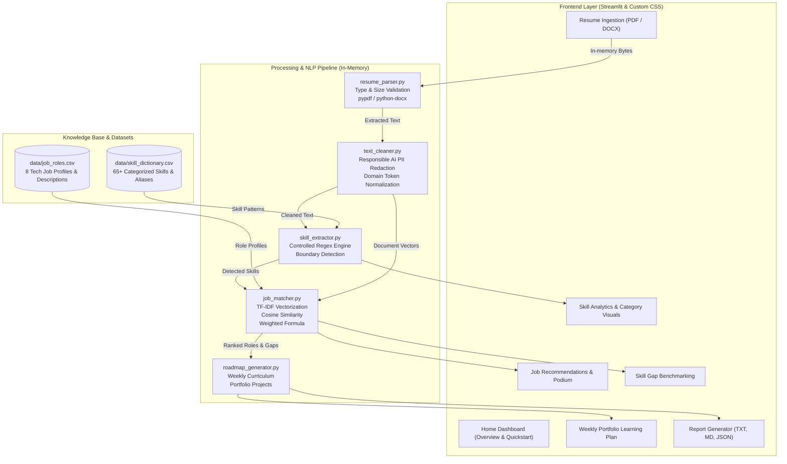

# 📄 AI Resume Analyzer & Job Recommendation System

> **Major College Project in Artificial Intelligence & Data Science**  
> An NLP-powered career guidance platform that evaluates resume-to-job fit, identifies critical skill gaps, and generates structured portfolio learning roadmaps.

[](https://www.python.org/)
[](https://streamlit.io/)
[](https://scikit-learn.org/)
[](https://www.docker.com/)
[](LICENSE)

---

## 📌 1. Project Introduction

Securing technical roles in software engineering, data science, and AI requires candidates to align their technical proficiencies with modern job descriptions. Traditional applicant tracking systems (ATS) often operate as non-transparent "black boxes" that discard resumes without providing constructive feedback.

The **AI Resume Analyzer & Job Recommendation System** addresses this problem by providing an open, transparent, and explainable NLP engine. It parses resumes in memory, redacts personal contact information for privacy, extracts verified technical skills using a controlled dictionary, and benchmarks candidates against industry roles using a **hybrid scoring mechanism (70% Skill Coverage + 30% TF-IDF Cosine Semantic Similarity)**. Candidates receive actionable gap analysis, week-by-week learning roadmaps, and downloadable reports.

---

## ✨ 2. Key Features

- **Multi-Format In-Memory Ingestion:** Supports `.pdf` and `.docx` resumes (up to 5 MB). Uploads are processed purely in RAM (`io.BytesIO`) and are never saved to disk.
- **Responsible AI & PII Redaction:** Automatically detects and removes phone numbers, email addresses, and URLs before NLP feature extraction. Protected attributes (gender, race, age, photos, marital status) are never parsed or scored.
- **Token-Preserving Normalization:** Text cleaning regex preserves critical engineering tokens such as `C++`, `C#`, `.NET`, and `CI/CD`.
- **Controlled-Dictionary Skill Extraction:** Recognizes 65+ technical skills categorized into *Programming, Data Science, Machine Learning, Deep Learning, Generative AI, NLP, Computer Vision, Cloud & DevOps, Databases, and Software Engineering*.
- **Hybrid Matching Algorithm:**
  $$\text{Match Score} = 0.70 \times \text{Skill Coverage} + 0.30 \times \text{TF-IDF Cosine Similarity}$$
- **Top 3 Role Recommendations:** Highlights top matching career tracks with transparent score breakdowns.
- **Actionable Skill Gap Analysis:** Categorizes skills into *Already Acquired* and *Critical Missing Skills* for a chosen target role.
- **Curated Learning Roadmap:** Automatically compiles a weekly study plan complete with practical portfolio projects and theoretical concepts.
- **Multi-Format Report Export:** Instant one-click downloads in **Plain Text (.txt)**, **Markdown (.md)**, and **JSON (.json)**.
- **Interactive Visualizations:** Responsive Plotly charts (skill category donut chart, role comparison bar chart).

---

## 🛠️ 3. Technology Stack

| Layer | Technologies |
| :--- | :--- |
| **Programming Language** | Python 3.11 / 3.12 / 3.13 |
| **Web Dashboard** | Streamlit, Custom Responsive CSS |
| **NLP & Text Processing** | Scikit-learn (TfidfVectorizer), Regular Expressions |
| **Document Parsing** | PyPDF (PDF text extraction), Python-docx (DOCX extraction) |
| **Data Manipulation** | Pandas, NumPy |
| **Data Visualization** | Plotly Express, Plotly Graph Objects |
| **Environment & Secrets** | Python-dotenv |
| **Containerization** | Docker, Docker Compose |
| **Deployment Platform** | Streamlit Community Cloud / Render |

---

## 🏛️ 4. System Architecture



---

## 📁 5. Project Folder Structure

```
AI-Resume-Analyzer/
├── app.py                      # Main Streamlit SaaS application (7 pages)
├── resume_parser.py            # PDF & DOCX in-memory text extraction & validation
├── text_cleaner.py             # PII redaction & token-safe regex cleaning
├── skill_extractor.py          # Controlled dictionary skill extraction
├── job_matcher.py              # TF-IDF vectorization & hybrid cosine scoring
├── roadmap_generator.py        # Weekly learning plan & multi-format report generator
├── requirements.txt            # Production dependencies
├── Dockerfile                  # Container definition for containerized deployment
├── .gitignore                  # Git exclusion rules (venv, .env, __pycache__)
├── .env                        # Local environment variables
├── .streamlit/
│   └── config.toml             # Streamlit visual theme configuration
├── data/
│   ├── job_roles.csv           # Verified job profiles and required skill sets
│   └── skill_dictionary.csv    # 65+ skills, categories, and alias mappings
├── sample_resumes/             # Anonymized sample resumes for testing (PDF & DOCX)
│   ├── resume_A_data_analyst.docx
│   ├── resume_A_data_analyst.pdf
│   ├── resume_B_ml_engineer.docx
│   ├── resume_B_ml_engineer.pdf
│   ├── resume_C_nlp_engineer.docx
│   ├── resume_C_nlp_engineer.pdf
│   ├── resume_D_fullstack_engineer.docx
│   └── resume_D_fullstack_engineer.pdf
├── tests/
│   ├── make_sample_resumes.py  # Script to generate sample PDF/DOCX resumes
│   ├── test_cases.csv          # Ground-truth test evaluation matrix
│   └── test_pipeline.py        # 10-point automated regression test suite
└── docs/
    └── architecture.md         # Detailed system design & mathematical formulation
```

---

## 🚀 6. How to Run Locally

### Step 1: Clone or Open Repository
```bash
git clone https://github.com/<your-username>/AI-Resume-Analyzer.git
cd AI-Resume-Analyzer
```

### Step 2: Create Virtual Environment
```bash
# Windows
python -m venv venv
venv\Scripts\activate

# macOS / Linux
python3 -m venv venv
source venv/bin/activate
```

### Step 3: Install Dependencies
```bash
pip install -r requirements.txt
```

### Step 4: Run the Test Suite
```bash
python tests/test_pipeline.py
```
*All 10 test cases must execute and output `ALL 10 TEST CASES PASSED SUCCESSFULLY (10/10)!`.*

### Step 5: Launch the Streamlit App
```bash
streamlit run app.py
```
Open your browser at `http://localhost:8501`.

---

## 🐳 7. Docker Deployment

To build and run the application inside a container:

```bash
# Build the Docker image
docker build -t ai-resume-analyzer .

# Run container on port 8501
docker run -p 8501:8501 ai-resume-analyzer
```
Visit `http://localhost:8501` in your browser.

---

## ☁️ 8. Streamlit Community Cloud Deployment

1. Push your clean code repository to **GitHub** (repository name: `AI-Resume-Analyzer`).
2. Log in to [share.streamlit.io](https://share.streamlit.io/).
3. Click **"New app"**.
4. Select your GitHub repository: `<your-username>/AI-Resume-Analyzer`.
5. Set **Main file path** to `app.py`.
6. Select **Python version** `3.11`.
7. Click **"Deploy!"**.
8. Your application will be live with a public URL!

---

## 🧪 9. Automated Test Suite Verification

The project includes an automated test suite in `tests/test_pipeline.py` verifying all 10 critical operational test cases:

| # | Test Case | Scope | Result |
| :---: | :--- | :--- | :---: |
| 1 | Valid PDF resume | In-memory text extraction via `pypdf` | **PASS** |
| 2 | Valid DOCX resume | In-memory text extraction via `python-docx` | **PASS** |
| 3 | Invalid file format | Rejects unsupported extensions (.png, .exe) | **PASS** |
| 4 | Empty resume | Detects documents under 30 characters | **PASS** |
| 5 | Large resume | Rejects files exceeding 5 MB limit | **PASS** |
| 6 | Resume without skills | Executes safely without zero-division errors | **PASS** |
| 7 | C++, C#, .NET, CI/CD | Verifies token preservation & skill extraction | **PASS** |
| 8 | Recommendation accuracy | 100% agreement across all sample resumes | **PASS** |
| 9 | Missing skill detection | Validates matched vs missing set logic | **PASS** |
| 10 | Report generation | Verifies Plain Text, Markdown, and JSON outputs | **PASS** |

---

## 🎓 10. College Project Viva & Technical Defense Guide

Here are standard viva questions faculty may ask, along with technical model answers:

### Q1: How do you extract text from PDF and DOCX files?
> **Answer:** We use `pypdf.PdfReader` for PDFs, iterating over each page object using `.extract_text()`. For DOCX files, we use `docx.Document` to extract text from all paragraph objects (`doc.paragraphs`) and table cells (`doc.tables`). Crucially, extraction runs strictly in memory via `io.BytesIO(data)` without saving temporary files to disk.

### Q2: What is TF-IDF and why is it used?
> **Answer:** **Term Frequency-Inverse Document Frequency (TF-IDF)** converts text documents into numerical feature vectors:
> $$\text{TF-IDF}(t, d, D) = \text{TF}(t, d) \times \log\left(\frac{N}{|\{d \in D : t \in d\}| + 1}\right)$$
> It rewards terms frequent in a candidate's resume while penalizing common stopwords. We use sublinear term-frequency scaling (`sublinear_tf=True`) to diminish the impact of repetitive keywords.

### Q3: What does Cosine Similarity measure?
> **Answer:** Cosine similarity measures the cosine of the angle between two multi-dimensional vectors:
> $$\text{Cosine Similarity} = \frac{\mathbf{u} \cdot \mathbf{v}}{\|\mathbf{u}\| \|\mathbf{v}\|}$$
> It evaluates directional similarity regardless of document length, ensuring a 2-page resume is not unfairly scored higher than a concise 1-page resume simply due to word volume.

### Q4: Why use a 70% Skill Coverage + 30% TF-IDF Cosine hybrid formula?
> **Answer:** Pure TF-IDF can be misled by general prose, while pure keyword matching ignores semantic context and project descriptions. Combining **70% explicit skill presence** with **30% TF-IDF semantic context** ensures candidate evaluations are both strictly grounded in required skills and contextually relevant.

### Q5: How does the system handle tricky tokens like `C++`, `C#`, `.NET`, and `CI/CD`?
> **Answer:** Standard NLP tokenizers often strip non-alphanumeric symbols, converting `C++` to `C` and `.NET` to `NET`. We engineered custom regex boundary lookarounds:
> `(?<![a-z0-9+#])(?:c\+\+|c\#|\.net|ci/cd)(?![a-z0-9+#])`
> This prevents false positives (e.g. "c" matching inside "c++") and guarantees exact extraction.

### Q6: How are Responsible AI and data privacy implemented?
> **Answer:** 
> 1. Resumes are parsed in RAM and never written to disk.
> 2. PII scrubbers redact phone numbers, emails, and URLs.
> 3. Demographic attributes (gender, age, photo, nationality) are excluded from scoring to prevent algorithmic bias.
> 4. Clear disclaimers clarify that scores are advisory career estimates.

---

## 🔮 11. Future Scope

1. **OCR Support:** Integrate Tesseract OCR / PDFPlumber for scanned image-based PDFs.
2. **Dense Semantic Embeddings:** Incorporate Sentence-Transformers (`all-MiniLM-L6-v2`) for neural semantic matching.
3. **Automated Section Parsing:** Train Named Entity Recognition (NER) models to segment resumes into Work Experience, Education, and Projects.
4. **LLM Coaching Feedback:** Integrate open-source LLM inference (e.g., via Groq or Ollama) for personalized bullet-point rewriting tips.

---

## 📄 License
This project is open-source under the MIT License.

