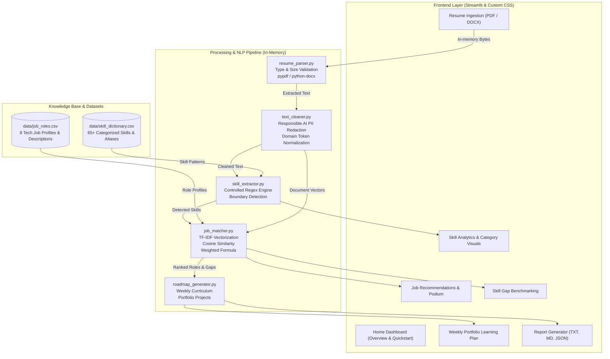

# System Architecture & Technical Design

## 1. High-Level Architecture Flowchart

## 2. Match Scoring Algorithm

The matching algorithm balances explicit skill presence with semantic context:

$$\text{Match Score} = 0.70 \times \text{Skill Coverage} + 0.30 \times \text{TF-IDF Cosine Similarity}$$

Where:
- **Skill Coverage ($70\%$):** 
  $$\text{Coverage} = \frac{\text{Required Skills Found in Resume}}{\text{Total Required Skills for Role}} \times 100$$
- **TF-IDF Cosine Similarity ($30\%$):**
  $$\text{Cosine Similarity} = \frac{\mathbf{v}_{\text{resume}} \cdot \mathbf{v}_{\text{role}}}{\|\mathbf{v}_{\text{resume}}\| \|\mathbf{v}_{\text{role}}\|}$$
  Computed over unigrams and bigrams $(1, 2)$ with sublinear term-frequency scaling.

## 3. Responsible AI & Data Privacy Guardrails
1. **Zero Disk Storage:** Resumes are parsed in RAM (`io.BytesIO`) and discarded upon session closure.
2. **PII Removal:** Emails, phone numbers, and URLs are stripped before tokenization.
3. **No Protected Attributes:** The engine never parses or scores candidate gender, age, race, religion, photo, or marital status.
4. **Advisory Tooling:** Clear disclaimers reinforce that match scores are educational guidelines, not automated hiring gates.
